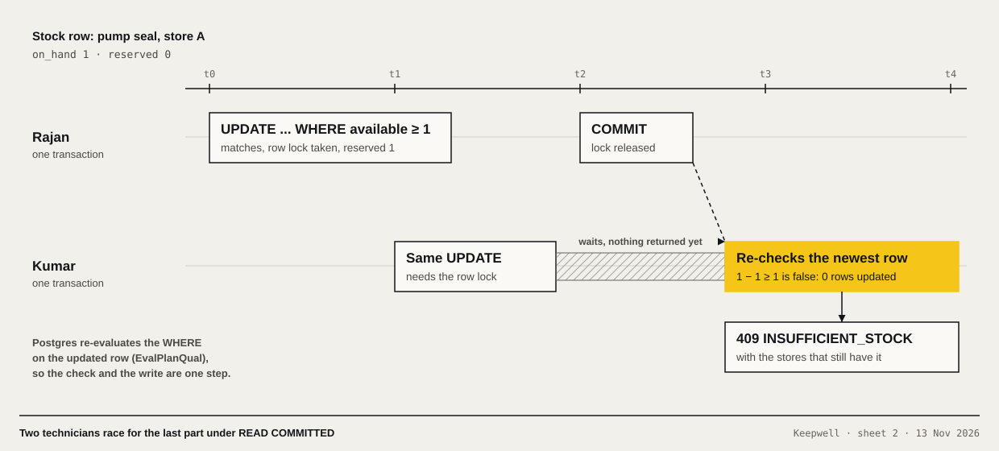

# Two technicians, one last part

A technician finds a leaking pump seal at 21:00 and reserves the last one in store A. At the same moment a second technician, on another job, reserves the same seal. Only one of them can have it, stock must never go negative, and the loser should be told where else the part is, not handed a generic error.

<picture>
  <source media="(prefers-color-scheme: dark)" srcset="../assets/diagrams/reservation-race-dark.svg">
  
</picture>

## The rule

Every stock change goes through one ledger service, and a reservation is a single conditional update. In shape (pseudocode, not the product's code):

```
reserve(item, store, qty):
    rows = UPDATE stock_levels
              SET reserved = reserved + qty
            WHERE item = :item AND store = :store
              AND on_hand - reserved >= :qty        -- the check lives in the write
    if rows == 1:
        append ledger row, write reservation, outbox event   -- same transaction
        return Reserved
    else:
        record the rejected attempt                           -- also committed
        return Insufficient(available, other stores that have it)   -> 409
```

The database also holds `CHECK (reserved >= 0 AND reserved <= on_hand)` as a last line of defence.

## Why this is correct under READ COMMITTED

Postgres runs at its default isolation level here. When the second `UPDATE` reaches a row the first transaction has locked, it waits. Once the first commits, Postgres does not use the row version it originally saw: it re-evaluates the `WHERE` clause against the newest version (the EvalPlanQual recheck). With one unit gone, `on_hand - reserved >= 1` is false, the update touches zero rows, and the service answers `409 INSUFFICIENT_STOCK` with the stores that still have stock.

So the check and the write are one statement and can't be split by a race. The alternatives were weighed and recorded in an architecture decision:

| Option | Why not |
|---|---|
| `SELECT ... FOR UPDATE`, check in Java, then `UPDATE` | correct, but holds the lock across round trips, and checking before locking brings the race back |
| Optimistic version column with retry | on a hot row the retries pile up; no gain for a single-row inequality |
| `SERIALIZABLE` with retry | strongest, but the most retries and the hardest to reason about for a pilot |

Multi-item reservations take the row locks in sorted `(item, store)` order first, so two jobs reserving the same two parts can't deadlock, and retry once if Postgres still reports one.

## How it is proven

- **The race itself.** An integration test lines threads up on a barrier and fires them at one stock row at once: 2 threads for 1 unit, 50 for 7, and 200 for 37. Exactly the available units succeed, every other thread gets a clean "insufficient" with the alternative store, and the row and the ledger agree afterwards. It runs against real PostgreSQL in Testcontainers.
- **The ledger.** Property-based tests (jqwik) apply random sequences of receipts, reservations, issues, returns and adjustments and check that stock levels always equal the ledger sums.
- **A rejection is a fact, not a shrug.** A refused reservation writes an attempt row and an `inventory.reservation_rejected.v1` event, and replays the same answer under its `Idempotency-Key`. The planner can see what technicians asked for and didn't get.

## Under load

In the scale test (synthetic data on one laptop, see the [README](../README.md#scale)), twelve per cent of all requests were reservations on three deliberately hot stock rows per tenant. The reservation path, one conditional update, two inserts and the alternatives lookup, took 3.8 ms in its query plan on the largest tenant.
