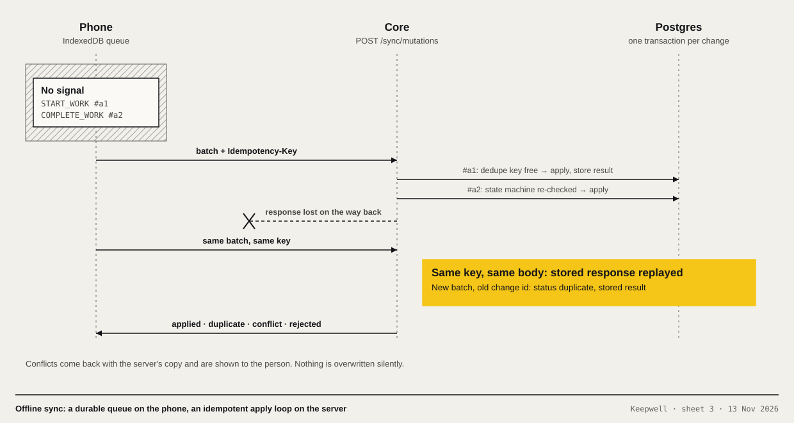

# Finishing a job with no signal

Plant rooms, basements and lift motor rooms are where maintenance happens and where phones lose signal. A technician has to be able to start a job, tick the checklist, take photos, record readings and complete it there, and the office has to see exactly that once the phone is back in range: nothing lost, nothing done twice, and nothing quietly overwritten.

<picture>
  <source media="(prefers-color-scheme: dark)" srcset="../assets/diagrams/offline-sync-dark.svg">
  
</picture>

## A log of what the person did, not a copy of the world

The phone keeps an ordered queue of changes in IndexedDB. Each change carries an id made on the device, the record it touches, the version the phone last saw, and when it happened:

```
change = { clientMutationId: uuid, entity: work order 1034, type: COMPLETE_WORK,
           baseVersion: 7, occurredAt: 21:14, payload: {...} }
```

There are a fixed number of change types (start, pause, complete, note, checklist answer, photo, reserve part, issue part, and the procedure steps and sign-offs). The screen shows "Saved on this phone" as soon as a change is in the queue, and the header counts what is still waiting.

## The server's apply loop

`POST /sync/mutations` takes a batch with an `Idempotency-Key`. Each change is applied in order, in its own transaction, so one bad change can't poison the rest (pseudocode):

```
for change in batch (in the order the phone made them):
    begin
      stored = find result by (tenant, person, clientMutationId)
      if stored: answer duplicate with the stored result; continue
      authorise as that person (the same rules as the REST API)
      lock the record; compare baseVersion with the current version
      merge by type:
          notes, photos         -> append
          checklist answer      -> apply unless that item changed since baseVersion
          status change         -> re-check against the work-order state machine
          stock                 -> through the ledger, never past the invariant
          anything else stale   -> conflict, with the server's copy attached
      save the result next to the dedupe key
    commit
answer [applied | duplicate | conflict | rejected] per change
```

Two keys make retries safe at two levels. If the whole response is lost, the phone resends the same batch with the same `Idempotency-Key` and gets the identical response body back. If a change shows up again in a new batch, its `clientMutationId` is found and the stored result comes back as `duplicate`.

## The phone's side of the protocol

The queue has its own rules, each covered by a unit test:

- changes are sent in the order they were made, at most one per record per batch, so the next one is rebased on the new version;
- a later change never overtakes an earlier one that is stuck in conflict, in flight or in backoff;
- an unsent checklist answer is replaced by a newer answer to the same item; notes always append;
- failed batches back off exponentially with jitter, and anything left in flight after a crash is resent, because the server dedupes by id;
- an applied or duplicate result marks the change synced; a conflict keeps the server's copy for the person to resolve.

Pulling works the same way in reverse: `GET /sync/briefcase` gives a technician their jobs, assets, checklists, procedures and stock, with a watermark; `GET /sync/changes?after=` returns what changed since, including jobs that were reassigned away, so the phone drops them. Watermarks may resend a change but never miss one.

## Times and conflicts

`occurredAt` is stored with each change, but server time drives state times, and `baseVersion` decides staleness, so a phone with a wrong clock can't rewrite history. Two technicians completing the same job offline is a real case: the second gets a `conflict` with the server's copy, and the app shows it to them instead of dropping their work.

## Found under load

The scale test caught a real bug here. A sync batch ran inside the idempotency wrapper's transaction, holding one pooled connection, while each change opened its own transaction on a second connection. Ten concurrent batches held all ten connections and waited for more, until the pool timed out after 30 seconds: in one run the app stopped answering for about a minute. The batch now runs outside a wrapper transaction and stores its response afterwards in its own transaction. A test holds all but one connection and sends four concurrent batches: before the fix all four failed, after it all four succeed.

## What the demo shows

The [offline tour](../assets/gifs/offline-sync.gif) is recorded against the live demo with the browser switched offline: start, complete, "Saved on this phone", then the signal returns, the queue drains, and the job appears completed on the office list.
