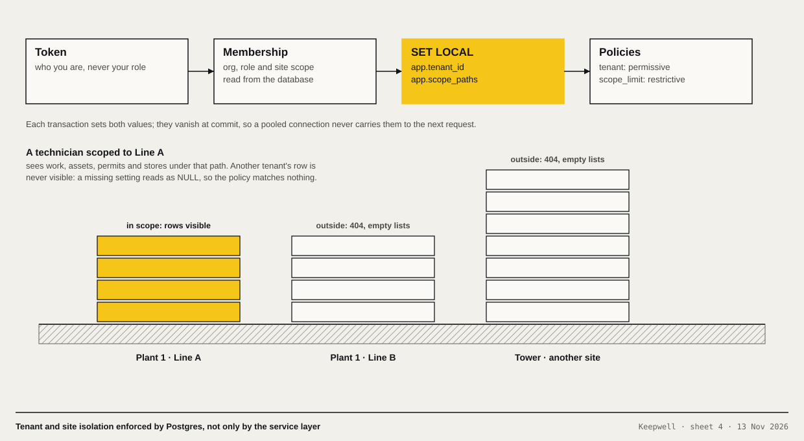

# Tenant and site isolation in Postgres

Many organisations share one Keepwell database. The worst failure is one of them reading another's work orders, and the most common way that happens is a query that forgot a `where tenant_id = ...`. So the boundary is enforced twice: by checks in the service layer, and by PostgreSQL row-level security underneath them. A forgotten check then returns nothing instead of someone else's data.

<picture>
  <source media="(prefers-color-scheme: dark)" srcset="../assets/diagrams/rls-isolation-dark.svg">
  
</picture>

## Roles in the database

- The API connects as an application role that owns nothing and has no `BYPASSRLS`. Migrations run as a separate owner role.
- Every tenant table has `tenant_id`, row-level security enabled **and forced**, so even the owner is bound when it runs as itself. The November audit counted 71 tenant tables, all forced.
- Every new table ships with its policy and an isolation test in the same change.

## Identity travels in the transaction

The token only says who you are. Membership, role and site scope are read from the database for the organisation in the `X-Org-Id` header, never taken from the token. Then, inside each transaction (pseudocode):

```
begin
  set_config('app.tenant_id',   <org id>,              local = true)
  set_config('app.scope_paths', '*' or '<path>,<path>', local = true)
  ... the request's queries ...
commit                                   -- both settings vanish here
```

Transaction-local settings matter with a connection pool: a connection handed to the next request can't carry the previous person's tenant. Background jobs run per tenant the same way, as a system actor.

## Two policies, one permissive and one restrictive

```
policy tenant  (permissive):   tenant_id = current_setting('app.tenant_id', true)::uuid
policy scope   (restrictive):  app_scope_allows(location_path)
```

`current_setting(..., true)` returns NULL when nothing was set, and `NULL = anything` is not true, so a code path that forgot to set the tenant reads zero rows. It fails closed.

Site scope serves large customers who limit people to some locations, a technician on Line A, a supervisor for one tower. Work orders, assets, stores and PM schedules carry a materialised `location_path`, kept current by triggers even when a site moves. The restrictive policy lets a row through only when its path starts with one of the person's scope prefixes (`'*'` means the whole organisation). Permits, PM occurrences and stock levels follow their parent row.

## What the person sees

- A record in another organisation is **404**, the same as a record that does not exist. A 403 would confirm it exists.
- Inside the organisation but outside your scope: lists leave it out, direct ids are 404, and request bodies that name it are 400.
- A write the database refuses that the service layer did not catch is also mapped to 404, not to a 500.

## Making it fast without making it leaky

The scope check runs once per row, so its cost shows at scale. At 200,000 work orders the SLA-risk query took 8.8 ms as the owner with no RLS and 57 ms as the application role. The scope function contained a sub-select, which Postgres can't inline. Rewritten as one inlinable expression with the same results, the same query took 9 to 10 ms under RLS: a 1,466-row read went from 1,466 function calls to none. A test compares the old and new functions for every edge case (organisation-wide, unset, empty, several prefixes, stray commas, NULL paths) and checks that scoped and unscoped sessions still see exactly their rows.

A faster-looking shortcut was tried and rejected: an `OR` inside the policy made desk reads quick but cost scoped users their index range (33 to 225 ms), because under RLS a user-written `LIKE` is not leakproof and can't become an index condition. Because this touches tenancy, the change is marked for a security review before merge.

## How it is proven

- Isolation integration tests per feature area create two organisations and assert 404s, empty lists, fail-closed reads with no setting, and `WITH CHECK` refusing writes into the other tenant, for every new table.
- A generated authorisation matrix calls every route as every built-in role, a foreign tenant and an anonymous caller.
- A property-based test (60 tries of random site trees and scopes) checks that what a scoped person can see is exactly the rows under their prefixes.
- The demo itself ships a second organisation whose only job is to prove isolation.
